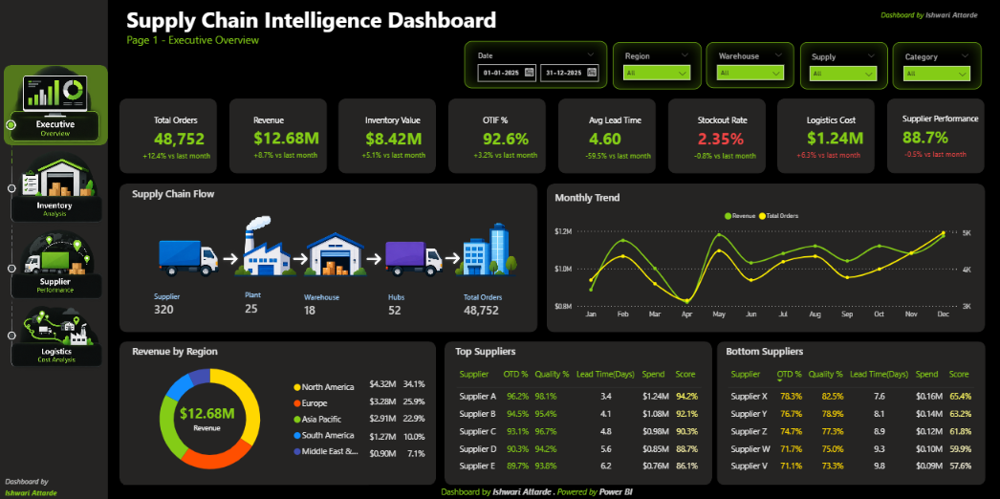
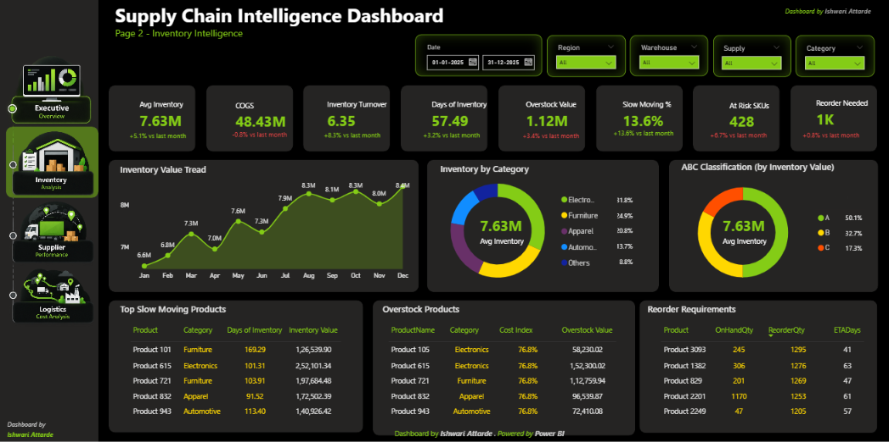
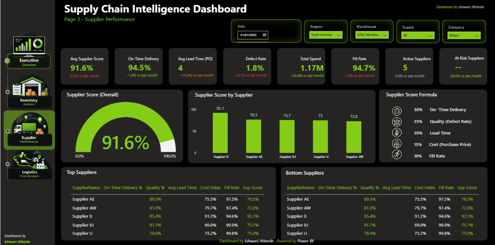
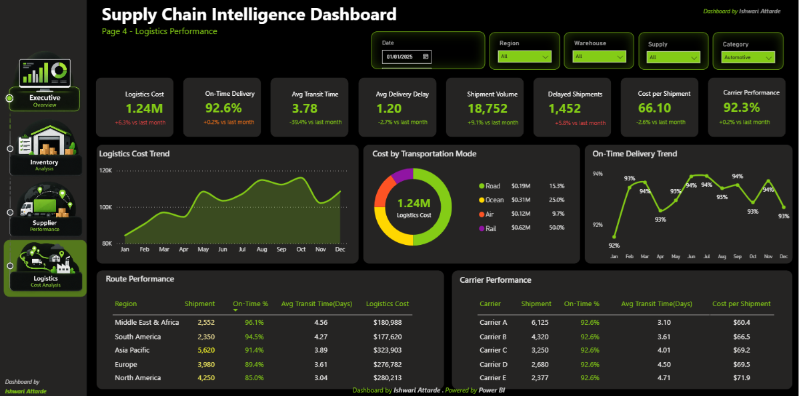
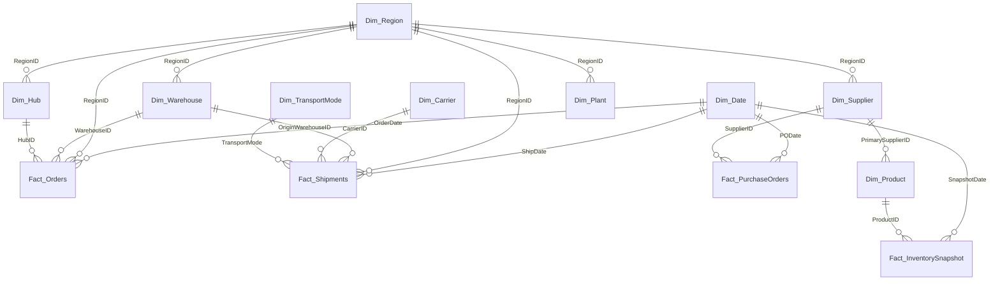

<div align="center">

# 📦 Supply Chain Intelligence Dashboard

**An end-to-end, 4-page Power BI dashboard covering executive KPIs, inventory, supplier and logistics performance.**


### 🔗 [**View the Live Interactive Dashboard**](https://app.powerbi.com/view?r=eyJrIjoiM2Q2MDgzMWQtYmNhNC00MjBmLThmZDUtNjg3YzE1NjJhMmQyIiwidCI6ImM5YzUwODQ4LWIwM2EtNGJlNC1iNjU1LTZlZGQ3ZmI4MWM1YSJ9)

[](https://app.powerbi.com/view?r=eyJrIjoiM2Q2MDgzMWQtYmNhNC00MjBmLThmZDUtNjg3YzE1NjJhMmQyIiwidCI6ImM5YzUwODQ4LWIwM2EtNGJlNC1iNjU1LTZlZGQ3ZmI4MWM1YSJ9)

</div>

---

## 📑 Table of Contents

1. [Project Overview](#-project-overview)
2. [Business Problem](#-business-problem)
3. [Dashboard Pages](#-dashboard-pages)
4. [Key Insights](#-key-insights)
5. [Dataset & Data Model](#%EF%B8%8F-dataset--data-model)
6. [KPI Definitions](#-kpi-definitions)
7. [Tools & Technologies](#%EF%B8%8F-tools--technologies)
8. [Repository Structure](#-repository-structure)
9. [How to Use](#-how-to-use)
10. [Author](#-author)

---

## 🎯 Project Overview

This project is a **Supply Chain Intelligence Dashboard** built in **Power BI**. It gives supply chain leaders a single place to monitor the full flow:

**Supplier → Plant → Warehouse → Hub → Customer Order**

The dashboard covers calendar year **2025** and tracks **48,752 orders**, **320 suppliers**, **25 plants**, **18 warehouses** and **52 hubs** across 5 global regions. Pages support slicing by **Date, Region, Warehouse, Supply category and Product category**.

## ❓ Business Problem

Supply chain teams often work with disconnected reports for orders, stock, suppliers and shipping. This makes it hard to answer questions such as:

- Are we delivering **on time and in full** (OTIF)?
- Where is cash tied up in **slow-moving or overstocked** inventory?
- Which **suppliers** are reliable, and which put supply at risk?
- Which **regions, carriers and transport modes** drive logistics cost and delays?

This dashboard answers these questions with one connected, interactive view.

---

## 📊 Dashboard Pages

### 1️⃣ Executive Overview
High-level health of the supply chain: orders, revenue, inventory value, OTIF %, lead time, stockout rate, logistics cost and supplier performance. Includes the supply chain flow, monthly revenue vs. orders trend, revenue by region, and top/bottom suppliers.


### 2️⃣ Inventory Intelligence
Inventory health and efficiency: average inventory, COGS, inventory turnover, days of inventory, overstock value, slow-moving %, at-risk SKUs and reorder needs. Includes inventory trend, category split, ABC classification and lists of slow-moving, overstock and reorder products.



### 3️⃣ Supplier Performance
Supplier scoring and risk: average supplier score, on-time delivery, PO lead time, defect rate, total spend, fill rate, active and at-risk suppliers. Includes a gauge, score by supplier, the weighted score formula and top/bottom supplier tables.



### 4️⃣ Logistics Performance
Shipping cost and delivery performance: logistics cost, on-time delivery, transit time, delay, shipment volume, delayed shipments, cost per shipment and carrier performance. Includes cost trend, cost by transport mode, on-time delivery trend, and route and carrier tables.



---

## 💡 Key Insights

Figures below are read from the dashboard screenshots (Executive page, all filters set to *All*).

| Area | Insight |
|------|---------|
| **Revenue** | Total revenue of **$12.68M** from **48,752 orders**. North America leads with **$4.32M (34.1%)**, followed by Europe (25.9%) and Asia Pacific (22.9%). |
| **Delivery** | OTIF stands at **92.6%** with an average lead time of **4.60 days**. |
| **Inventory** | Inventory value is **$8.42M**; inventory turnover is **6.35** with **57.49** days of inventory. Slow-moving stock is **13.6%** and **428 SKUs** are at risk. |
| **Stockouts** | Stockout rate is **2.35%**, highlighted in red as an area to watch. |
| **Suppliers** | Overall supplier performance is **88.7%**. Top suppliers score above 86%, while the bottom group scores below 66% with long lead times (7.6–9.8 days). |
| **Logistics** | Logistics cost is **$1.24M** across **18,752 shipments**, with **1,452** delayed. |

> The Inventory, Supplier and Logistics screenshots were captured with specific filter selections (for example a single category or region), so their numbers differ from the Executive page. Use the live dashboard to explore every combination.

---

## 🗄️ Dataset & Data Model

The dataset is in [`data/SupplyChain_Dashboard_Dataset.xlsx`](data/SupplyChain_Dashboard_Dataset.xlsx) and follows a **star schema** with 4 fact tables and 9 dimension tables.

### Fact tables

| Table | Rows | Description |
|-------|-----:|-------------|
| `Fact_Orders` | 48,752 | Customer orders with revenue, lead time, on-time / in-full / OTIF flags |
| `Fact_Shipments` | 18,752 | Shipments with carrier, transport mode, cost, transit and delay days |
| `Fact_InventorySnapshot` | 36,000 | Monthly product stock snapshots: value, COGS, days of inventory, overstock, reorder flags |
| `Fact_PurchaseOrders` | 12,000 | Supplier purchase orders with lead time, defects and PO value |

### Dimension tables

| Table | Rows | Description |
|-------|-----:|-------------|
| `Dim_Date` | 365 | Calendar for 2025 |
| `Dim_Region` | 5 | Regions |
| `Dim_Supplier` | 320 | Suppliers with category, tier, risk status, cost index and overall score |
| `Dim_Product` | 3,000 | Products with category, cost, price and ABC class |
| `Dim_Plant` | 25 | Manufacturing plants |
| `Dim_Warehouse` | 18 | Warehouses / distribution centres |
| `Dim_Hub` | 52 | Delivery hubs |
| `Dim_Carrier` | 5 | Carriers |
| `Dim_TransportMode` | 4 | Road, Ocean, Air, Rail |

### Data model



Column-level details are in [`docs/data_dictionary.md`](docs/data_dictionary.md).

---

## 📐 KPI Definitions

| KPI | Definition |
|-----|-----------|
| **Total Orders** | Count of `OrderID` |
| **Revenue** | Sum of `Revenue` |
| **OTIF %** | Orders with `OTIFFlag = 1` ÷ total orders |
| **Avg Lead Time** | Average of `LeadTimeDays` |
| **Inventory Value** | Sum of `InventoryValue` |
| **Inventory Turnover** | COGS ÷ Average Inventory |
| **Days of Inventory** | Average of `DaysOfInventory` |
| **Stockout Rate** | Share of snapshots with `StockoutFlag = 1` |
| **Slow Moving %** | Share of snapshots with `SlowMovingFlag = 1` |
| **Logistics Cost** | Sum of `ShippingCost` |
| **Cost per Shipment** | Logistics Cost ÷ number of shipments |
| **On-Time Delivery (Logistics)** | Shipments with `OnTimeFlag = 1` ÷ total shipments |
| **Supplier Score** | Weighted score (see below) |

**Supplier Score formula**

| Component | Weight |
|-----------|:------:|
| On-Time Delivery | 30% |
| Quality (Defect Rate) | 25% |
| Lead Time | 20% |
| Cost (Purchase Price) | 15% |
| Fill Rate | 10% |

More detail in [`docs/kpi_definitions.md`](docs/kpi_definitions.md).

---

## 🛠️ Tools & Technologies

- **Power BI Desktop**: data modelling, DAX measures, report design
- **Power Query**: data loading and transformation
- **DAX**: KPIs, time intelligence and scoring logic
- **Microsoft Excel**: source dataset
- **Power BI Service**: publishing and live sharing

---

## 📁 Repository Structure

```
supply-chain-intelligence-dashboard/
│
├── README.md
├── LICENSE
├── .gitignore
│
├── assets/
│   └── screenshots/
│       ├── 01_executive_overview.png
│       ├── 02_inventory_intelligence.png
│       ├── 03_supplier_performance.png
│       └── 04_logistics_performance.png
│
├── data/
│   └── SupplyChain_Dashboard_Dataset.xlsx
│
└── docs/
    ├── data_dictionary.md
    └── kpi_definitions.md
```

---

## 🚀 How to Use

1. **View online:** open the [live dashboard](https://app.powerbi.com/view?r=eyJrIjoiM2Q2MDgzMWQtYmNhNC00MjBmLThmZDUtNjg3YzE1NjJhMmQyIiwidCI6ImM5YzUwODQ4LWIwM2EtNGJlNC1iNjU1LTZlZGQ3ZmI4MWM1YSJ9) and use the filters at the top of each page.
2. **Explore the data:** clone the repo and open the Excel file.
   ```bash
   git clone https://github.com/<your-username>/supply-chain-intelligence-dashboard.git
   cd supply-chain-intelligence-dashboard
   ```
3. **Rebuild in Power BI Desktop:** choose *Get Data → Excel*, load all sheets, and create the relationships shown in the data model above.

---

## 👤 Author

**Ishwari Attarde**

- GitHub: [IshwariAttarde](https://github.com/your-username)
- LinkedIn: [https://www.linkedin.com/in/ishwariattarde/](https://www.linkedin.com/in/your-linkedin)

⭐ If you found this project useful, please give it a star!
